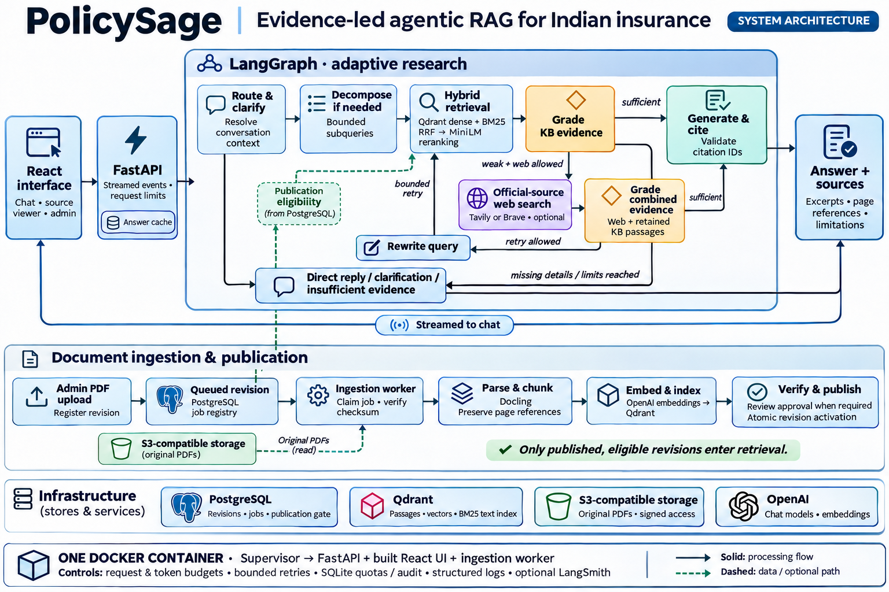

# PolicySage — Agentic RAG for Indian Insurance

Insurance policy documents can be lengthy and difficult to search, especially when the wording in a policy differs from the way someone asks a question. PolicySage lets users ask about Indian insurance policies in plain English and inspect the passages and sources behind the answer.

The LangGraph workflow adapts to the question and the evidence it finds. It can search published policy documents, assess whether they answer the question, consult selected official websites when permitted, or explain what information is missing.

[](docs/assets/policysage-architecture-hero.png)

## What you can do

- **Ask a question in plain English.** The assistant can use recent conversation context to resolve follow-ups and split a complex research question into smaller searches.
- **Find policy passages using hybrid search.** Dense retrieval and BM25 provide candidate passages. The workflow combines the rankings and uses a cross-encoder to rerank candidates.
- **Follow the research.** The chat interface shows stages as they run. Evidence grading determines whether to answer, ask for clarification, or consider bounded public-web research.
- **Inspect the sources.** References include titles, excerpts and page details where available. Source links may open the publisher's website or an accessible PDF.
- **Manage policy revisions.** Admins can upload or replace PDFs, review and approve revisions, retry failed processing jobs, and withdraw documents.

Try a question such as “How do cashless and reimbursement claims differ?” after publishing relevant policy documents. The excerpts let you check the conditions behind an answer, including whether it describes a particular insurer or policy version.

## How it works

Three design decisions shape the project:

- **Complementary retrieval signals.** Semantic search helps with paraphrases. BM25 helps match terms such as co-payment or room-rent limits. Fusion and reranking produce a shortlist for evidence grading.
- **Publication before retrieval.** PostgreSQL controls which revisions are searchable. The worker verifies a replacement before it becomes active, so an incomplete indexing attempt does not displace the previous published version.
- **Separate processing from chat.** The upload request registers the PDF and queues it. A separate worker parses, chunks, embeds and verifies the document, allowing chat to continue while new PDFs are being processed.

## Technology stack

| Area | Implementation |
| --- | --- |
| Frontend and API | React, Tailwind CSS, FastAPI, and streamed chat events |
| Workflow and models | LangGraph, OpenAI chat models and embeddings |
| Retrieval | Qdrant dense and BM25 search, reciprocal rank fusion, and a MiniLM cross-encoder |
| Document processing | Docling and semantic chunking |
| Storage | PostgreSQL for the revision registry, Qdrant for searchable passages, and S3-compatible storage for original PDFs |
| External research and tracing | Tavily or Brave for optional web research, structured application logs, and optional LangSmith traces |

## Quick start

Configure the services and copy the environment template as described in the [local setup guide](docs/setup.md). From the repository root in PowerShell:

```powershell
uv sync --locked --python 3.11
yarn --cwd frontend install --frozen-lockfile
yarn --cwd frontend build
uv run --locked python -m app.ingestion init
uv run --locked python -m uvicorn app.main:app --no-access-log --host 127.0.0.1 --port 8000
```

Start the ingestion worker in a second terminal with `uv run --locked python -m app.ingestion worker --watch`. Open `http://127.0.0.1:8000/` for chat and `/admin` for document management. Use the setup guide to configure Qdrant, import initial PDFs, or troubleshoot the worker.

For Docker Desktop, build with `docker build -t policysage:local .` and follow the [Docker startup commands](docs/setup.md#run-with-docker-desktop). One container starts the React frontend, FastAPI and ingestion worker locally or on [Render](docs/setup.md#deploy-on-render).

## Evaluation and limitations

The [software tests](tests/) cover selected behavior including routing, citation validation, admin access, and document publication and recovery. Retrieval relevance, answer correctness, and whether a citation supports a specific claim need separate evaluation.

Answers depend on the indexed policies and permitted public sources. Evidence can be incomplete and generated answers can be wrong. Terms vary by product and revision, so verify important details against the applicable original policy.

## Documentation

- [Architecture](docs/architecture.md) explains the workflow, storage boundaries, citation rules and engineering trade-offs.
- [Local setup](docs/setup.md) covers configuration, startup, ingestion and troubleshooting.
