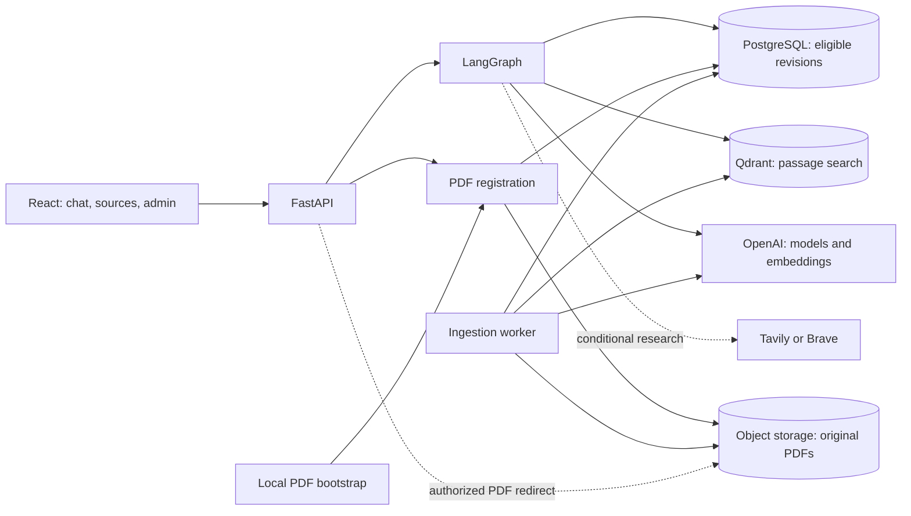
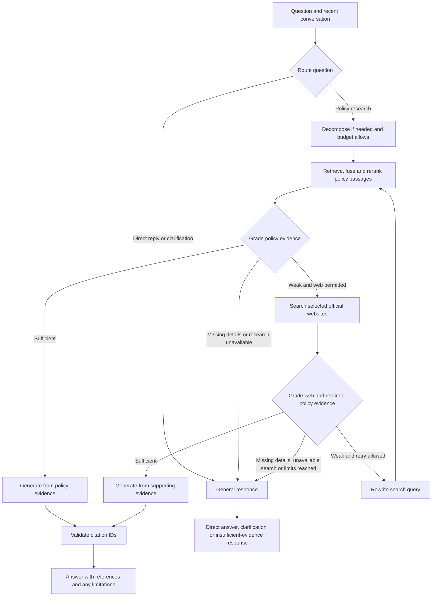

# PolicySage architecture

PolicySage separates interactive question answering from PDF processing. FastAPI serves the React interface and chat and admin APIs. A separate worker processes registered revisions. PostgreSQL decides which revisions are eligible for retrieval, Qdrant searches their passages, and S3-compatible storage holds the original PDFs.

The Docker container starts the same-origin React frontend and FastAPI alongside the ingestion worker as supervised processes. Both connect to the same PostgreSQL, Qdrant, and object storage. The web process also uses local SQLite for request quotas and auditing, so public deployment requires durable storage for those files. [Deployment setup](setup.md#deploy-on-render)

| Area | Responsibility |
| --- | --- |
| [Web entry point](../app/main.py) and [API](../app/api/) | Serve the built frontend, admit requests, stream chat progress and expose admin and PDF routes. |
| [RAG](../app/rag/) | Route questions, retrieve and grade evidence, research the web when permitted, and generate responses. |
| [Ingestion](../app/ingestion/) | Discover local PDFs, process queued revisions and verify, publish or clean up indexed records. |
| [Database](../app/db/) | Define the registry schema and manage revision state, job claims and publication queries. |
| [Infrastructure](../app/infrastructure/) | Access object storage, Qdrant and embedding services. |
| [Services](../app/services/) and [core](../app/core/) | Register and withdraw documents, enforce limits, record audit events, and centralize settings, budgets and tracing. |

## Question answering

Routing resolves the question in context and decides whether policy research is needed. Evidence grading happens after retrieval and identifies passages that support the question, missing information and whether the user needs to clarify. Query rewriting targets remaining evidence gaps and returns to policy retrieval before another web attempt can be considered. The graph can stop at each decision according to the evidence and remaining budget. [Workflow source](../app/rag/workflow.py)

### Retrieval and publication eligibility

The app loads a PostgreSQL revision snapshot lazily for each chat. Only active revisions without a withdrawal or pending review enter that snapshot. Each Qdrant query filters by those revision IDs and the configured embedding model. The dense branch uses query embeddings. The lexical branch queries the scored `text` index for BM25 ranking. Reciprocal rank fusion combines candidates, then a MiniLM cross-encoder reranks passages against the question. Semantic matching helps with paraphrases, while lexical scoring helps with distinctive policy terms and identifiers. Neither guarantees an exact identifier match or a relevant result. [Retrieval](../app/rag/retrieval.py) · [Qdrant queries](../app/infrastructure/qdrant_store.py)

### Citations and cache reuse

The answer generator receives selected passages with evidence IDs. It checks that returned and inline citation IDs refer to the evidence supplied for generation. A citation can carry a title, excerpt, URL and page range. ID validation checks that the cited source was available to the model. Whether a passage supports a particular statement still requires inspection.

For managed policy citations, enabling public downloads allows links to a stored revision through FastAPI. The endpoint checks the registry and redirects to a short-lived signed URL. With downloads disabled, a suitable publisher URL may be used. Web references point to external sources and may lack page numbers. Authorized admins can preview stored PDFs separately. [Citation generation](../app/rag/workflow.py) · [PDF routes](../app/api/document_sources.py)

Qualifying answers with citations can be reused from an in-memory cache. Reuse checks compatible conversation and settings context and a fingerprint of the published revisions. A semantic match also requires an equivalence check, which can use model calls. An exact hit can avoid graph execution. Cache expiry, restarts and revision changes limit reuse. [Answer cache](../app/rag/answer_cache.py)

## Document ingestion and lifecycle

1. Admin uploads and local bootstrap share registration logic. Registration records a pending upload in PostgreSQL, writes the original to object storage, then marks the revision staged or queued. Failed uploads require registration to be retried.
2. The worker claims queued work, verifies the stored PDF checksum, parses pages with Docling and PyMuPDF, and chunks the text while keeping page references. It embeds passages and writes Qdrant records. Stable IDs and matching payload checks let retries reuse completed work.
3. The worker verifies the expected records before publication. A review-required revision waits for approval. Once publishable, the worker checks the vectors and retires the old active revision and activates the replacement in one PostgreSQL transaction.
4. Withdrawal makes the document ineligible for new retrieval snapshots and disables new stored-PDF links. Old vectors remain during a six-minute cleanup grace period for in-flight requests. The worker later removes them. Original PDFs and revision history are retained.

The prior active revision remains available while a replacement is indexed. A worker interruption can leave unpublished vectors in Qdrant, but the registry gate excludes them from fresh searches. The worker recovers interrupted jobs and can verify records again before publishing. The Qdrant `is_active` payload field is retained and ingestion initializes it to false. PostgreSQL drives eligibility. [Registration](../app/services/document_service.py) · [Indexing and publication](../app/ingestion/service.py) · [Worker](../app/ingestion/worker.py) · [Registry](../app/db/document_repository.py)

| Store | Identity and contents |
| --- | --- |
| PostgreSQL | One `documents` row per revision. `document_id` identifies the logical policy, `id` identifies the revision, and `version` orders revisions of a document. Status, review and withdrawal fields control eligibility. |
| Qdrant | Passage text, dense vectors and chunk metadata, including revision, embedding model, page range and text offsets. Record IDs use the revision ID and a zero-padded chunk index. Qdrant point IDs are UUIDs derived from those record IDs. |
| Object storage | The registry stores the original object's key and SHA-256. New keys follow `<category>/<insurer>/<filename_stem>__d<document_id>_v<version>.pdf` using sanitized path components. |

## Safeguards and trade-offs

- **Adaptive research** saves web work when policy evidence suffices and can ask for clarification when details are missing. Routing and grading introduce extra model calls and can misjudge evidence.
- **Registry-controlled publication** keeps review and replacement decisions together. Retrieval depends on PostgreSQL being reachable, and vector cleanup follows publication asynchronously.
- **Background ingestion** keeps PDF parsing and embedding outside the upload request. Documents become searchable after processing and verification, so queued work requires a running worker.
- **Restricted web fallback** uses an allowlist of official sources and best-effort redaction of common personal identifiers before sending public queries. This narrows the available evidence and may leave some questions unresolved.

The API enforces body, request and concurrency limits. The graph applies provider timeouts, search and retry limits, and token budgets, including a reserve for the final answer. Admin routes use HTTP Basic authentication and require HTTPS in production mode. Request IDs and structured logs support diagnosis. Optional LangSmith tracing records execution details, with content capture governed by a separate setting. [Budgets](../app/core/) · [Request limits](../app/services/limits.py) · [Admin authorization](../app/api/admin_documents.py) · [Tracing](../app/core/observability.py)

## Verification and evaluation

The [test suite](../tests/) covers selected software behaviors such as API routing, citation ID validation, publication filtering, retries and admin access. A mocked test establishes how the code handles supplied inputs. Retrieval relevance, answer correctness and citation support require separate evaluation against labelled questions and original policy text. A live smoke test checks that the configured services work together. No completed quality benchmark is claimed here. See [local setup](setup.md) for the smoke-test procedure.
